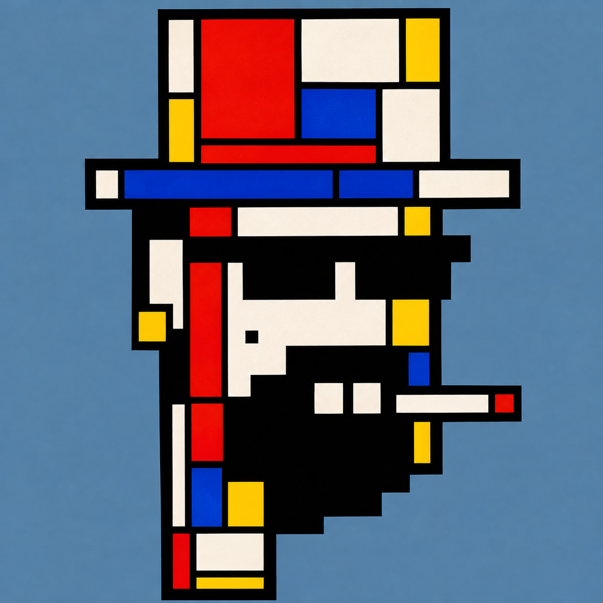

# Geometric Punk Studies

20 geometric portraits by Astral Lyrism, inspired by Piet Mondrian and De Stijl.

## First artwork

**Composition No. 8348** — 01/20, artist-approved. Reference: CryptoPunk #8348 (artist-selected). Edition: 1/1 planned, not minted.

## Status

- Public repository. Study 01 is completed; Studies 02–20 remain proposals.
- Source attributes, candidate traits, frequencies, and rankings remain unverified.
- Commercial derivative-rights and provenance review remain pending.
- GitHub Pages, contract deployment, and NFT minting remain unapproved. Nothing has been deployed or minted.

## Files

- `assets/works/composition-no-8348.png` — original artwork, unchanged.
- `assets/reference/study-01-reference.jpg` — earlier style reference, separate from the approved artwork.
- `metadata/` — artwork details and draft planning records.
- `planning/20-work-plan.csv` — 20-study plan. “High-frequency traits” is an unverified goal.
- `planning/research-protocol.md` — source verification method.
- `docs/` — undeployed gallery; artwork copy is byte-identical to the original.

## Sources

- [CryptoPunks](https://www.cryptopunks.app/)
- [Source gallery](https://www.cryptopunks.app/cryptopunks/all)
- [Larva Labs code](https://github.com/larvalabs/cryptopunks)

Independent project; not affiliated with CryptoPunks or Larva Labs. Repository visibility grants no artwork reuse rights. Third-party rights remain with their owners.
